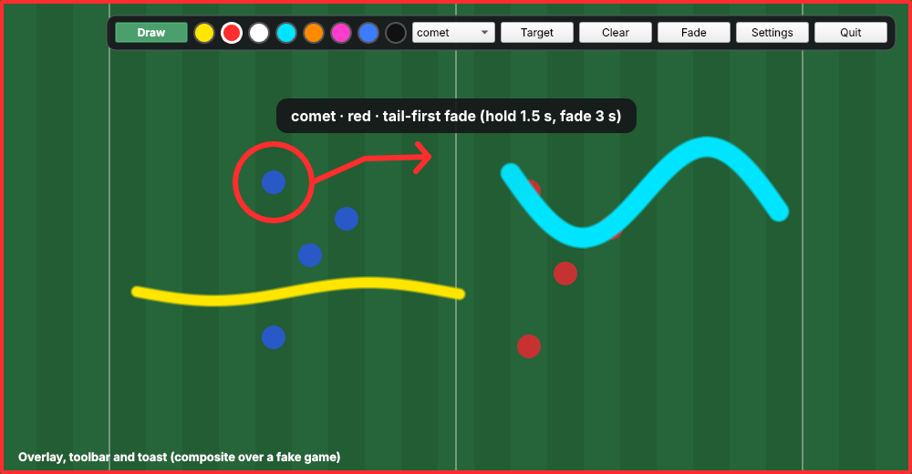
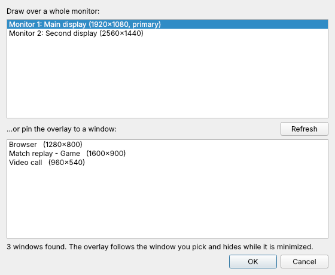
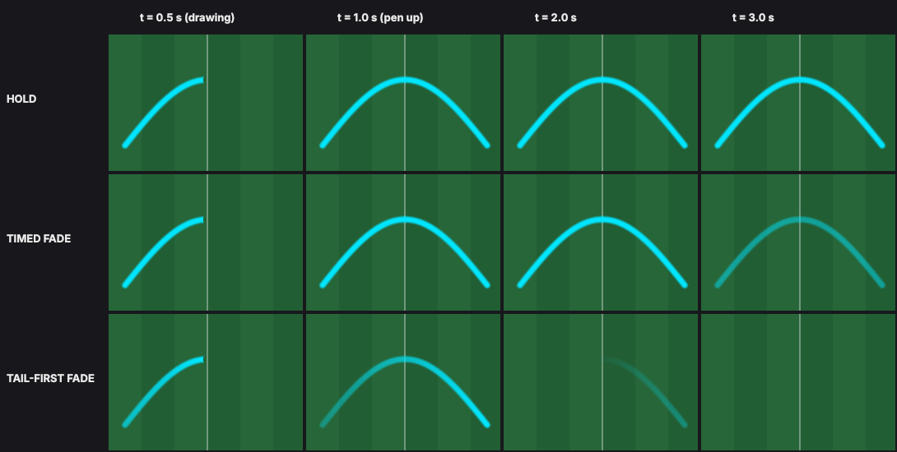
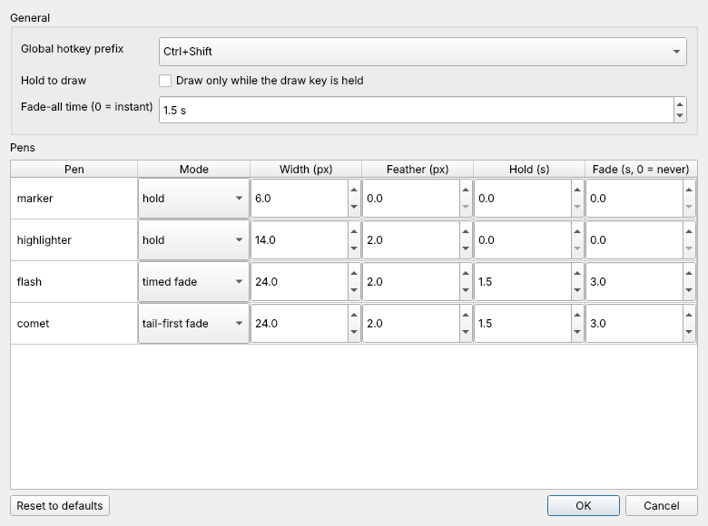

# Madden-Mode

Telestration technology over your favorite game/window. Named after the greatest NFL sports casters in the honor of John Madden.

Draw freehand marks on top of whatever is on your screen: circle a player, trace a route, highlight a gap. Marks can stay until you clear them or fade away on their own.



> **Status: early.** Built Windows-first, aimed at windowed and borderless windows (true fullscreen games often block overlays). The automated tests pass on Windows and Linux, but the overlay has **not yet been tried by hand on a real Windows desktop**, so expect rough edges. The screenshots are rendered offscreen: the overlay and toolbar are the real widgets, composited over a fake game.

## Quick start

You need [uv](https://docs.astral.sh/uv/) (it installs the right Python for you) and git. Run this in **PowerShell** on Windows, the platform this is built for. You do not need `make` or a separate Python install.

```powershell
# Install uv once (other platforms: see the uv docs)
powershell -ExecutionPolicy ByPass -c "irm https://astral.sh/uv/install.ps1 | iex"
```

Then **close that window and open a new PowerShell**, so the `uv` command is found:

```powershell
git clone https://github.com/vibecoder-1z3r0/Madden-Mode
cd Madden-Mode
uv sync
uv run python -m maddenmode
```

Then press **Ctrl+Shift+D** and drag with the left mouse button. To run it again another day, open PowerShell in the `Madden-Mode` folder and run `uv run python -m maddenmode`. To update, `git pull` and run `uv sync`.

> **Use Windows itself, not WSL.** Inside WSL the app runs as a Linux program: it cannot draw over your Windows apps, and the Windows hotkeys and window pinning are not used. WSL is fine for running the tests, but try the overlay on Windows.

To try it without a game, run the demo. It opens a window with a moving ball and puts the overlay on top:

```
uv run python -m maddenmode.demo
```

If something does not work, run `uv run python scripts/preflight.py`. It checks your setup.

## Using it

While draw mode is off, the overlay is invisible to the mouse: clicks go through to the game. Draw mode takes over the mouse and shows a border in the current pen's color.

**Global hotkeys** (work while a game has focus):

| Keys | Action |
|---|---|
| `Ctrl+Shift+D` | Toggle draw mode |
| `Ctrl+Shift+C` | Clear everything instantly |
| `Ctrl+Shift+F` | Fade everything out |
| `Ctrl+Shift+H` | Show or hide the toolbar |

**While drawing:**

| Keys | Action |
|---|---|
| `1` to `8` | Pick a color |
| `[` and `]` | Previous / next pen |
| `Esc` | Leave draw mode |

The **toolbar** (draggable, always on top) has the same controls as buttons, plus **Settings** and **Quit**. A **tray icon** has the same menu, so Quit is always reachable even with the toolbar hidden. A short **toast** message appears when the pen, color or mode changes.

### Choosing where to draw

By default the overlay covers your first monitor. Press **Target** on the toolbar (or **Where to draw...** in the tray menu) to change that:



- **A monitor:** pick any screen. Your choice is remembered.
- **A window (Windows only):** pin the overlay to one window. It sizes itself to that window, follows it when you move or resize it, and hides while it is minimized. If the window closes, it goes back to your saved monitor. A pinned window is not remembered after a restart.

Things to know about pinning: the overlay is always on top, so it also covers any other window that overlaps the pinned one, and marks keep their position from the window's top-left corner when it is resized.

### Pens

Each pen has a color, width, feather (softness of the edge, in pixels; 0 is a hard edge) and a dissipation mode:

| Pen | Color | Width / feather | What happens to its marks |
|---|---|---|---|
| marker | red | 6 / 0 | held until cleared |
| highlighter | yellow | 14 / 2 | held until cleared |
| flash | magenta | 8 / 2 | timed fade: solid for 1 s after you lift the pen, then fade over 2 s |
| comet | cyan | 8 / 2 | tail-first fade: each point holds 0.5 s, then fades over 1.5 s |



Every pen has a **hold** time and a **fade** time, each from 0.0 to 10.0 seconds. A fade of 0 means the pen never fades. Edit pens in **Settings**.

### Settings

Open **Settings** from the toolbar or tray. You can change the hotkey prefix (`Ctrl+Shift` or `Ctrl+Alt`, if a game already uses one), hold-to-draw (draw only while the draw key is held), the fade-all time and each pen. Settings are saved per user:

- Windows: `%APPDATA%\madden-mode\settings.json`
- Linux: `~/.config/madden-mode/settings.json`



A damaged settings file never stops the app: it starts with defaults and tells you.

## Troubleshooting

- **A hotkey does nothing, or a message says another app is using it:** switch the prefix to `Ctrl+Alt` in Settings.
- **The overlay does not appear over a game:** try the game in windowed or borderless mode.
- **The game is on another monitor:** press **Target** and choose that monitor.
- **The window list is empty or disabled:** pinning needs Windows, and only windows that are visible, not minimized and have a title are listed. Open the window and press **Refresh**.
- **On Linux:** hotkeys only work while the overlay has focus, because there is no global hotkey backend yet. Wayland restricts always-on-top overlays; X11 works better. If Qt fails to load, `make system-deps` installs the libraries it needs. It detects your distro from `/etc/os-release` and uses `apt` (Debian, Ubuntu) or `dnf` (Fedora, RHEL); for other distros it lists what to install. The Ubuntu path is tested; the Fedora package names are not yet tried on a real Fedora machine.

## Development

On Linux and macOS the Makefile has shortcuts:

```
make sync          # install dependencies
make check         # lint, format check, type check, tests (what CI runs)
make preflight     # check this machine
make screenshots   # regenerate the images above
make system-deps   # Linux only: libraries Qt needs (apt or dnf)
```

Windows does not have `make`. Run the same things directly (this is exactly what CI does on Windows):

| Instead of | Run in PowerShell |
|---|---|
| `make sync` | `uv sync --extra dev` |
| `make check` | `uv run ruff check .`, then `uv run ruff format --check .`, `uv run mypy src/` and `uv run pytest tests` |
| `make preflight` | `uv run python scripts/preflight.py` |
| `make screenshots` | `uv run python scripts/screenshots.py` |
| `make system-deps` | not needed on Windows |

The code is split so the decisions live outside the windows: `controller`, `pen`, `scene`, `dissipation` and `settings_store` have no GUI imports and are tested directly. The `gui/` package is a thin Qt layer. Tests render offscreen, so they need no display.

CI runs lint, type checking, the tests and a startup smoke test on Linux and Windows. See [CONTRIBUTING.md](CONTRIBUTING.md) for commit conventions and the policy for pull requests from forks, and [ARCHITECTURE.md](ARCHITECTURE.md) for the decisions behind the design. Ideas we have not built yet are in [FUTURE_CONSIDERATIONS.md](FUTURE_CONSIDERATIONS.md).

## Contributing and AI attribution

Commits follow [Conventional Commits](https://www.conventionalcommits.org/) and carry an [AI Attribution](AIA_ATTRIBUTION.md) line. [SESSION_LOG.md](SESSION_LOG.md) records how the project was built, turn by turn.

## License

MIT. See [LICENSE](LICENSE).
